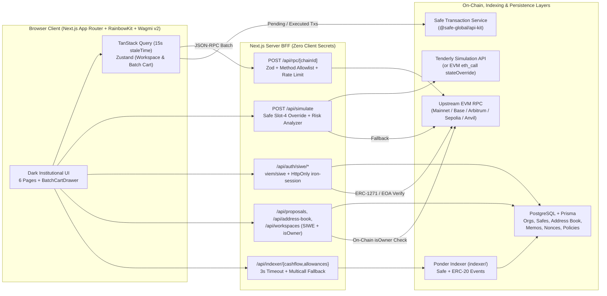

# AegisVault — Institutional Multi-Sig Treasury & Governance Portal

**AegisVault** is a production-grade **Institutional Multi-Sig Treasury & Governance Portal** built with **Next.js 16 (App Router, Turbopack)**, **TypeScript (`strict` + `noUncheckedIndexedAccess`)**, **`viem`**, **`wagmi`**, **RainbowKit v2**, **Safe Smart Accounts (v1.4.1)**, **Tenderly / EVM State-Override Pre-Execution Simulation**, **Ponder Event Indexing**, and **PostgreSQL + Prisma**.

Designed as a **flat, high-density, dark-mode institutional Web3 terminal** (zero drop shadows, zero gradients, crisp `1px` borders, `Inter` + `JetBrains Mono` with `tabular-nums`), AegisVault eliminates blind signing by letting finance teams, DAOs, and institutional signers batch payouts atomically (`MultiSendCallOnly`), simulate exact asset diffs and internal call traces *before* co-signing, audit and bulk-revoke risky ERC-20 token approvals, and resolve competing transaction nonces cleanly.

---

## Table of Contents

1. [System Architecture & Trust Boundaries](#1-system-architecture--trust-boundaries)
2. [Core Features (Page-by-Page)](#2-core-features-page-by-page)
3. [Security Model & Web3 Guardrails](#3-security-model--web3-guardrails)
4. [Tech Stack](#4-tech-stack)
5. [Project Structure (Feature-Sliced Design)](#5-project-structure-feature-sliced-design)
6. [BFF API Reference](#6-bff-api-reference)
7. [Database Schema (PostgreSQL + Prisma)](#7-database-schema-postgresql--prisma)
8. [Ponder Event Indexer](#8-ponder-event-indexer)
9. [Getting Started (Local Development)](#9-getting-started-local-development)
10. [Local Foundry Anvil Fork & E2E Testing](#10-local-foundry-anvil-fork--e2e-testing)
11. [Available Scripts](#11-available-scripts)

---

## 1. System Architecture & Trust Boundaries

AegisVault enforces a **hybrid Web2/Web3 architecture** with strict separation between canonical on-chain truth and off-chain institutional context:



### Data Boundary Rules
- **Canonical On-Chain & Safe State:** Safe owners, signing threshold, current on-chain nonce, ETH/ERC-20 balances, live token allowances, pending proposals, and EIP-712 confirmations come exclusively from EVM RPC nodes (via `/api/rpc/[chainId]`) and the Safe Transaction Service (`@safe-global/api-kit`).
- **Off-Chain Institutional Metadata (PostgreSQL + Prisma):** Organization workspaces, labeled counterparties (Address Book), proposal titles/descriptions, invoice references, internal audit comments, spending policy soft thresholds, and single-use SIWE authentication nonces live in PostgreSQL behind an encrypted `HttpOnly` session cookie.
- **Event Indexing Layer (`indexer/`):** A standalone Ponder TypeScript workspace indexes Safe execution/governance events and ERC-20 `Transfer`/`Approval` events to power historical activity charts, CSV accounting exports, and allowance discovery—with clean automatic fallback to direct Multicall reads if Ponder is not running locally.

---

## 2. Core Features (Page-by-Page)

### `/treasury` — Treasury Overview
- **KPI Strip (4 Flat Cards):** Total Liquid Value (USD), Stablecoin Ratio (%), Signer Quorum (`M / N` + Current On-Chain Nonce + Safe Version), and Pending Queue Count.
- **Token Holdings Table:** Queries native ETH and tracked ERC-20 `balanceOf`, `decimals`, and `symbol` in a single `viem/actions` `multicall` batch. Displays pure `BigInt`-formatted balances, USD values, allocation %, and one-click **Add to Batch**.
- **Historical Treasury Activity Chart:** Flat Recharts bar visualization (solid fills, zero gradients) backed by Ponder indexer data (with graceful fallback to executed Safe history), plus **Export CSV** (`papaparse`) for accounting reconciliation.
- **Recent Executed Transactions:** Decoded actions reconciled against the Institutional Address Book with block explorer links.

### `/queue` — Multi-Sig Queue & Nonce Manager
- Fetches pending transactions from `@safe-global/api-kit`, enriches them with PostgreSQL metadata (`ProposalMeta`), decodes calldata (including nested `MultiSendCallOnly` calls), and runs static security risk analysis.
- **Nonce Grouping Engine:** Groups pending proposals by ascending nonce:
  - Highlights the **Next Executable Nonce** (matching on-chain `safe.nonce()`).
  - Wraps 2+ proposals sharing a nonce in an amber **Nonce Conflict Group** warning that executing one automatically invalidates all competing proposals at that nonce.
  - Provides a **Create Rejection / Replacement Tx** button that constructs a `0 ETH` empty-data self-transfer to the Safe at the exact nonce.
- **Per-Proposal Controls:** Signer progress pill (`X / M`), inline **Simulate** modal, **Co-Sign (EIP-712)**, **Execute On-Chain** (enabled only when confirmations ≥ threshold AND nonce === current on-chain nonce), and link to the full Audit Report.

### `/batch-builder` — Multi-Payout & CSV Batch Creator
- **Single Payout Form (React Hook Form + Zod):** Token selector with live Safe balances, recipient input with Address Book quick-fill and EIP-55 validation, decimal amount parsed strictly via `viem` `parseUnits` (never JavaScript floats), optional memo & invoice reference, and live **Spending Policy** soft-warning checks.
- **CSV Bulk Import (`papaparse`):** Upload `recipient,token,amount,memo` CSV schedules with a row-by-row validation preview flagging invalid addresses, unsupported tokens, or amounts exceeding current Safe balance before queuing valid rows into the Batch Cart.

### `/allowances` — ERC-20 Allowance Auditor & Batch Revoker
- Merges Ponder-indexed `Approval` events with curated DeFi protocol spenders (Uniswap Permit2, SwapRouter02, Aave V3 Pool, 1inch Router v6, CoW VaultRelayer) and reads live allowances in one `multicall` batch.
- Flags unlimited approvals (`allowance >= maxUint256 / 2n`) with a high-contrast `CRITICAL` badge.
- Supports single **Queue Revoke** (`approve(spender, 0n)`) or bulk multi-select **Queue Selected Revocations** to revoke multiple spenders in one atomic `MultiSendCallOnly` signature.

### `/governance` — Signers, Threshold, Policies & Address Book
- **Safe Security Posture Card:** Safe version, signing threshold (`M of N`), on-chain nonce, EIP-1967 fallback handler, and transaction guard address.
- **Signers & Threshold Tab:** Lists current owners with Address Book labels and provides proposal builders for `addOwnerWithThreshold`, `removeOwner` (automatically resolving Safe's linked-list `prevOwner` / `SENTINEL_OWNERS`), and `changeThreshold`.
- **Institutional Address Book Tab (SIWE-Gated):** Full CRUD for verified counterparties (`VENDOR`, `SIGNER`, `PROTOCOL`, `TREASURY`) with instant label propagation across all views.
- **Spending Policy Warnings Tab (SIWE-Gated):** Configure soft per-token single-transaction limits (stored as stringified `BigInt` wei) and invoice/memo requirements.

### `/proposals/[safeTxHash]` — Proposal Deep-Dive & Audit Report
- **Pre-Execution Simulation Panel:** Status (`Simulation Will Succeed` / `Will Revert`), estimated gas, simulation engine badge (`Tenderly` or `EVM StateOverride`), Net Asset Balance Changes table, expandable Internal Call Trace tree, and Decoded Calldata Inspector (unpacking nested `MultiSendCallOnly` calls).
- **Automated Security Risk Report & `CRITICAL` Gate:** If any `CRITICAL` finding is detected (e.g., non-canonical `DELEGATECALL` or unlimited ERC-20 approval), the **Co-Sign** button remains locked until the signer checks an explicit acknowledgement box.
- **Co-Signer Audit Trail & Discussion:** Displays confirmed vs. awaiting owners alongside SIWE-authenticated internal audit comments.

### Persistent Right Slide-Over: `<BatchCartDrawer />`
- Backed by Zustand (`src/features/tx-proposal/model/batch-cart.store.ts`), persisting queued payouts, revocations, and governance calls across page navigation.
- Supports reordering, item removal, running `/api/simulate` on the entire `MultiSendCallOnly` bundle, and proposing as one Safe transaction.

---

## 3. Security Model & Web3 Guardrails

1. **Zero Client-Side Secret Exposure:** RPC API keys, Tenderly keys, `DATABASE_URL`, and `IRON_SESSION_SECRET` are strictly server-only and loaded via lazy Zod getters in [env.ts](file:///Users/macbook/Desktop/projects/aegis-vault/src/shared/config/env.ts). All client `wagmi` transports route to `/api/rpc/[chainId]` with `{ batch: true }`.
2. **Hardened JSON-RPC Proxy (`/api/rpc/[chainId]`):** Validates `chainId`, enforces a strict 13-method allowlist (rejecting `debug_*`, `admin_*`, `personal_*`, etc. with `403`), caps payload size at 256 KiB, and applies sliding-window per-IP rate limiting (120 req/min).
3. **Replay-Proof SIWE (`viem/siwe` + `iron-session`):** No `siwe` or `ethers` packages. Nonces are generated via `generateSiweNonce()`, stored in PostgreSQL with a 5-minute TTL, and **atomically deleted** during verification (`deleteMany` with `expiresAt > now`). Signatures are verified via `viem/siwe` `verifySiweMessage` (supporting both EOAs and ERC-1271 smart wallets) and stored exclusively in an encrypted `HttpOnly`, `SameSite=Strict`, `Secure` (prod) cookie.
4. **On-Chain Safe Ownership Enforcement:** Every mutating metadata endpoint (`/api/proposals`, `/api/proposals/[safeTxHash]/comments`, `/api/address-book`, `/api/workspaces`) verifies both the SIWE session AND on-chain Safe ownership (`safe.isOwner(session.address)`).
5. **Safe Storage Slot-4 Simulation Override:** `/api/simulate` constructs a pre-validated Safe signature (`v = 1`) and overrides Safe v1.4.1 storage slot `0x...04` (`threshold`) to `1` so multi-sig proposals can be accurately dry-run before collecting quorum (eliminating `GS020`/`GS026` false reverts).
6. **`DELEGATECALL` Firewall:** Batch proposals always enforce `onlyCalls: true` targeting canonical `@safe-global/safe-deployments` `MultiSendCallOnly` v1.4.1 addresses. Any queued transaction using `operation === 1` against a non-canonical contract is flagged `CRITICAL`.
7. **Pure `BigInt` Financial Math:** All balances, wei amounts, USD cents, micro-USD prices, and basis-point allocations use native `BigInt` and `viem` `parseUnits`/`formatUnits`—zero floating-point arithmetic.
8. **Zero SSR Hydration Mismatches:** `wagmi` runs with `ssr: true` + `cookieStorage`, hydrated from `headers()` via `cookieToInitialState` in [layout.tsx](file:///Users/macbook/Desktop/projects/aegis-vault/src/app/layout.tsx), while `wagmiConfig` and `QueryClient` (`staleTime: 15_000`) are instantiated inside `useState` in [providers.tsx](file:///Users/macbook/Desktop/projects/aegis-vault/src/app/providers.tsx).
9. **Hardened HTTP Security Headers ([next.config.ts](file:///Users/macbook/Desktop/projects/aegis-vault/next.config.ts)):** Strict `Content-Security-Policy`, `X-Frame-Options: DENY`, `X-Content-Type-Options: nosniff`, `Referrer-Policy: strict-origin-when-cross-origin`, and `Permissions-Policy`.
10. **Explicit 9-State Transaction Lifecycle:** Handles `idle`, `simulating`, `awaiting_wallet_signature`, `user_rejected`, `proposed_offchain`, `pending_onchain`, `confirmed`, `reverted`, and `wrong_network`. Rejecting a wallet signature displays a clean dismissible notice without clearing form inputs or Batch Cart items.

---

## 4. Tech Stack

| Layer | Technologies |
| :--- | :--- |
| **Framework & Language** | Next.js 16 (App Router, Turbopack), React 19, TypeScript (`strict: true`, `noUncheckedIndexedAccess: true`) |
| **Web3 & Safe SDK** | `viem` v2, `wagmi` v2, `@rainbow-me/rainbowkit` v2, `@safe-global/protocol-kit` v8, `@safe-global/api-kit` v5, `@safe-global/safe-deployments` |
| **Data & State** | `@tanstack/react-query` v5, `zustand` v5, `react-hook-form`, `zod` v4 |
| **Auth & Database** | `viem/siwe` (native EIP-4361), `iron-session`, PostgreSQL, Prisma v6 |
| **Indexing & Simulation** | Ponder (`indexer/`), Tenderly Simulation API + EVM `eth_call` `stateOverride` fallback |
| **UI & Charts** | Tailwind CSS v4, ShadCN Base UI (Nova) flattened to `shadow-none`, `lucide-react`, `recharts`, `papaparse` |
| **Testing & Local Chain** | Foundry Anvil (`foundry/fork.sh`), Playwright, Synpress v4 |

---

## 5. Project Structure (Feature-Sliced Design)

Dependency flow is strictly unidirectional: **`app` → `widgets` → `features` → `entities` → `shared`**.

```text
aegis-vault/
├── src/
│   ├── app/
│   │   ├── (dashboard)/
│   │   │   ├── layout.tsx                      # Wraps all 6 routes in <AppShell />
│   │   │   ├── treasury/page.tsx               # KPIs, Multicall holdings, charts, CSV export
│   │   │   ├── queue/page.tsx                  # Nonce grouping, conflicts, rejection tx, co-sign
│   │   │   ├── batch-builder/page.tsx          # Single payout + PapaParse CSV bulk import
│   │   │   ├── allowances/page.tsx             # Multicall allowance auditor + bulk revoke
│   │   │   ├── governance/page.tsx             # Posture, signer ops, Address Book, policies
│   │   │   └── proposals/[safeTxHash]/page.tsx # Deep-dive simulation, risk gate, comments
│   │   ├── api/
│   │   │   ├── auth/siwe/{nonce,verify,session,logout}/route.ts
│   │   │   ├── rpc/[chainId]/route.ts          # Allowlisted, rate-limited JSON-RPC BFF proxy
│   │   │   ├── simulate/route.ts               # Tenderly + EVM slot-4 state-override simulator
│   │   │   ├── proposals/route.ts              # SIWE + isOwner protected ProposalMeta CRUD
│   │   │   ├── proposals/[safeTxHash]/comments/route.ts
│   │   │   ├── address-book/route.ts           # SIWE + isOwner protected counterparty labels
│   │   │   ├── workspaces/route.ts             # Safe workspaces & spending policies
│   │   │   └── indexer/{cashflow,allowances}/route.ts
│   │   ├── layout.tsx                          # Server Component: dark mode + Wagmi SSR cookies
│   │   ├── providers.tsx                       # Client Component: Wagmi + Query + RainbowKit darkTheme
│   │   └── globals.css                         # Tailwind v4 obsidian dark flat tokens
│   ├── widgets/
│   │   ├── app-shell/                          # Sidebar, SafeSwitcher, Topbar, Guard Banners
│   │   └── batch-cart-drawer/                  # Persistent right slide-over MultiSend drawer
│   ├── features/
│   │   ├── tx-proposal/                        # Safe SDK wrappers, nonce grouping, cart store, actions
│   │   ├── tx-simulation/                      # Simulation hook, types, SimulationPanel UI
│   │   ├── allowance-auditor/                  # Multicall + Ponder allowance discovery hook
│   │   ├── siwe-auth/                          # SIWE session/sign-in hooks, badge & auth gate
│   │   └── governance-ops/                     # Address Book & Spending Policy hooks
│   ├── entities/
│   │   ├── safe/                               # Safe types, workspace store, Multicall hooks
│   │   └── token/                              # <AddressDisplay /> and <TokenAmount />
│   └── shared/
│       ├── config/                             # env.ts, chains.ts, wagmi.ts, tokens.ts, safe-deployments.ts
│       ├── web3/                               # abis/, bigint.ts, multisend.ts, decode.ts, security.ts, server-client.ts
│       ├── auth/                               # session.ts (lazy iron-session + requireSafeOwnerSession)
│       ├── db/                                 # prisma.ts (singleton client)
│       ├── lib/                                # utils.ts, rate-limit.ts, empty-module.ts
│       └── ui/                                 # 19 flattened ShadCN Base UI primitives + StatusBadge
├── indexer/                                    # Standalone Ponder TypeScript event indexer
├── prisma/                                     # schema.prisma + seed.ts
├── foundry/                                    # fork.sh (local Anvil fork + owner impersonation)
├── e2e/                                        # Synpress MetaMask setup + Playwright E2E suite
├── next.config.ts                              # CSP & security headers + Turbopack config
└── playwright.config.ts
```

---

## 6. BFF API Reference

| Endpoint | Method | Auth | Description |
| :--- | :--- | :--- | :--- |
| `/api/rpc/[chainId]` | `POST` | Rate-limited | Proxies single & batched JSON-RPC 2.0 requests (`1`, `8453`, `42161`, `11155111`, `31337`). Blocks disallowed methods with `403`. |
| `/api/simulate` | `POST` | Rate-limited | Pre-execution Safe simulator using `v = 1` pre-validated signature and storage slot-4 threshold override (`1`). Returns asset diffs, call trace, decoded calldata, and risk findings. |
| `/api/auth/siwe/nonce` | `GET` | Public | Issues a single-use cryptographic SIWE nonce stored in PostgreSQL (5-minute TTL). |
| `/api/auth/siwe/verify` | `POST` | Nonce + Sig | Atomically consumes nonce, validates domain & signature via `viem/siwe`, sets encrypted `HttpOnly` cookie. |
| `/api/auth/siwe/session` | `GET` | Cookie | Returns `{ authenticated, address?, chainId?, issuedAt? }`. |
| `/api/auth/siwe/logout` | `POST` | Cookie | Destroys the `HttpOnly` SIWE session cookie. |
| `/api/proposals` | `GET` / `POST` | `POST`: SIWE + `isOwner` | Reads or upserts off-chain `ProposalMeta` (title, description, invoiceRef, category). |
| `/api/proposals/[safeTxHash]/comments` | `POST` | SIWE + `isOwner` | Appends an authenticated internal audit comment to a proposal. |
| `/api/address-book` | `GET` / `POST` / `DELETE` | Write: SIWE + `isOwner` | Manages verified institutional vendor/protocol/signer labels. |
| `/api/workspaces` | `GET` / `POST` | `POST`: SIWE + `isOwner` | Lists saved Safe workspaces and upserts per-token `SpendingPolicy` rules. |
| `/api/indexer/cashflow` | `GET` | Public | Fetches Ponder monthly cashflow series with 3s timeout and graceful fallback. |
| `/api/indexer/allowances` | `GET` | Public | Fetches Ponder-discovered `(token, spender)` approval pairs with graceful fallback. |

---

## 7. Database Schema (PostgreSQL + Prisma)

Defined in [prisma/schema.prisma](file:///Users/macbook/Desktop/projects/aegis-vault/prisma/schema.prisma):
- **`Organization`** — Top-level institutional tenant owning Safes and Address Book entries.
- **`SafeWorkspace`** — Saved Safe addresses (`(address, chainId)` unique, EIP-55 checksummed).
- **`SiweNonce`** — Single-use authentication nonces indexed by `expiresAt`.
- **`ProposalMeta`** — Off-chain proposal title, description, invoice reference, and category linked by unique `safeTxHash`.
- **`ProposalComment`** — Timestamped audit review notes authored by verified Safe signers.
- **`AddressBookEntry`** — Verified counterparty labels (`VENDOR`, `SIGNER`, `PROTOCOL`, `TREASURY`) scoped globally or per chain.
- **`SpendingPolicy`** — Per-token soft warning threshold (`maxSingleTxWei` as stringified `BigInt`) and `requiresMemo` flag.

---

## 8. Ponder Event Indexer

The standalone indexer in `indexer/` tracks:
- **Safe Events:** `ExecutionSuccess`, `ExecutionFailure`, `AddedOwner`, `RemovedOwner`, `ChangedThreshold`, `SafeReceived`.
- **ERC-20 Events:** `Transfer` (filtered where `from` or `to` is the active Safe) and `Approval` (filtered where `owner` is the active Safe).

Exposes GraphQL at `/graphql` and REST JSON endpoints at `/api/cashflow` and `/api/allowances` on `http://127.0.0.1:42069`.

```bash
cd indexer
pnpm install
pnpm dev
```

If Ponder is not running locally, the Next.js app automatically degrades to Safe Transaction Service history and direct `viem` Multicall reads with zero UI errors.

---

## 9. Getting Started (Local Development)

### Prerequisites
- **Node.js** `>= 22`
- **pnpm** `>= 10` (configured with `allowBuilds` in [pnpm-workspace.yaml](file:///Users/macbook/Desktop/projects/aegis-vault/pnpm-workspace.yaml))
- **PostgreSQL** (running locally or hosted)
- **Web3 Browser Wallet** (MetaMask, Rabby, or Coinbase Wallet extension) — or WalletConnect mobile wallet

### Step 1: Install Dependencies
```bash
cd aegis-vault
pnpm install
```

### Step 2: Configure Environment Variables
Copy `.env.example` to both `.env` (read by Prisma CLI) and `.env.local` (read by Next.js):

```bash
cp .env.example .env
cp .env.example .env.local
```

Generate a 32+ character session secret:
```bash
openssl rand -base64 32
```

Update `.env` and `.env.local` with your values:

| Variable | Scope | Required | Description |
| :--- | :--- | :--- | :--- |
| `NEXT_PUBLIC_APP_URL` | Public | Yes | App origin (e.g. `http://localhost:3000`) |
| `NEXT_PUBLIC_WC_PROJECT_ID` | Public | Optional | Reown/WalletConnect Project ID from [cloud.reown.com](https://cloud.reown.com) (only needed for mobile/QR wallets; browser extensions work without it) |
| `NEXT_PUBLIC_DEFAULT_CHAIN_ID` | Public | Yes | Default active chain (`8453` Base, `11155111` Sepolia, `31337` Anvil) |
| `DATABASE_URL` | Server | Yes | PostgreSQL connection URL (e.g. `postgresql://macbook@localhost:5432/aegisvault`) |
| `IRON_SESSION_SECRET` | Server | Yes | Random 32+ character secret for `HttpOnly` SIWE session cookies |
| `RPC_URL_MAINNET` / `_BASE` / `_ARBITRUM` / `_SEPOLIA` | Server | Optional | Custom Alchemy/Infura RPC URLs (public RPC fallbacks are built in) |
| `RPC_URL_ANVIL` | Server | Optional | Local Anvil RPC URL (defaults to `http://127.0.0.1:8545`) |
| `TENDERLY_ACCOUNT` / `_PROJECT` / `_ACCESS_KEY` | Server | Optional | Tenderly credentials for full trace simulation (falls back to live EVM `eth_call` `stateOverride` when omitted) |
| `PONDER_API_URL` | Server | Optional | Ponder indexer URL (defaults to `http://127.0.0.1:42069`) |

### Step 3: Initialize PostgreSQL & Seed Demo Data
```bash
createdb aegisvault
pnpm db:push && pnpm db:seed
```

This seeds the **Kodesy Institutional Treasury** organization, default Safe workspace, 5 verified Address Book entries, and 2 sample `BigInt` spending policies (USDC & WETH).

### Step 4: Start the Development Server
```bash
pnpm dev
```

Open [http://localhost:3000](http://localhost:3000). Click **Connect Wallet** in the top-right bar to connect your browser extension, then click **Sign In to Edit Metadata** to authenticate your SIWE session.

---

## 10. Local Foundry Anvil Fork & E2E Testing

### Running Against a Local Anvil Mainnet Fork (Zero Real Funds)
1. Install Foundry if not already installed:
   ```bash
   curl -L https://foundry.paradigm.xyz | bash
   export PATH="$HOME/.foundry/bin:$PATH"
   foundryup
   ```
2. Start the deterministic fork (`chainId: 31337`):
   ```bash
   pnpm anvil:fork
   ```
3. In MetaMask, add a custom network (`RPC: http://127.0.0.1:8545`, `Chain ID: 31337`, `Symbol: ETH`) and import Anvil's default funded test key (`0xac0974bec39a17e36ba4a6b4d238ff944bacb478cbed5efcae784d7bf4f2ff80`).
4. Switch the sidebar workspace to **Local Anvil Mainnet Fork**.

### Running Playwright & Synpress E2E Tests
```bash
# Build production bundle
pnpm build

# Build Synpress MetaMask cache (first run)
pnpm e2e:cache

# Run full Playwright + Synpress E2E test suite
pnpm e2e
```

---

## 11. Available Scripts

| Command | Purpose |
| :--- | :--- |
| `pnpm dev` | Start Next.js 16 dev server with Turbopack |
| `pnpm build` | Build production bundle and verify TypeScript & routes |
| `pnpm start` | Start production server |
| `pnpm typecheck` | Run strict `tsc --noEmit` (`strict` + `noUncheckedIndexedAccess`) |
| `pnpm lint` | Run ESLint |
| `pnpm db:generate` | Generate Prisma Client |
| `pnpm db:push` | Push Prisma schema to PostgreSQL |
| `pnpm db:seed` | Seed demo Organization, Safe, Address Book & Spending Policies |
| `pnpm anvil:fork` | Start local Foundry Anvil fork with Safe funding & owner impersonation |
| `pnpm e2e:cache` | Build Synpress MetaMask wallet cache |
| `pnpm e2e` | Run Playwright & Synpress E2E tests |
